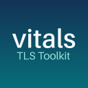

# vitals - TLS Toolkit

Modern TLS (1.2 and 1.3), HTTP and DNS for consoles whose own TLS can no longer reach today's
servers: vitals replaces Sony's SSL and HTTP libraries with its own rewrites, the SSL one on
[Mbed TLS](https://www.trustedfirmware.org/projects/mbed-tls/), adds an up-to-date certificate
store, and lets you redirect hosts and DNS lookups to community servers. Games and apps keep calling
the same functions, so they work unchanged.

| Console | Folder | Runs on | What it covers |
|---|---|---|---|
| PS Vita | [psv/](psv/) | firmware 3.60 or 3.65, taiHEN | the browser, apps and games |
| PlayStation 3 | [ps3/](ps3/) | firmware 4.93 CEX, Evilnat's Cobra CFW | games and apps (the XMB, with PSN and the browser, keeps Sony's) |

Each folder's README covers installing, using and building that console's vitals.

## Downloads

The releases pages on [GitHub](https://github.com/nyirsh/vitals/releases) and
[GitLab](https://gitlab.com/nyirsh/vitals/-/releases) have the Vita's `vitals-app.vpk` and the PS3's
`vitals-app.pkg`.

## Layout

- `psv/`: the Vita's kernel plugin, libssl, libhttp, browser TLS provider and app, built in
  VitaSDK's Docker image (`make` in `psv/`).
- `ps3/`: the PS3's libssl, libhttp, boot plugin, DNS kernel plugin and app, built in the
  [vitals-ps3-sdk](https://github.com/nyirsh/vitals-ps3-sdk) Docker image (`make` in `ps3/`).

`make` at the top builds both consoles. Name one to work on just that console (`make ps3`, `make psv`), and add a command to run it: `make clean` for both, `make ps3 clean` or `make psv test` for one.

Both consoles share one version and one changelog, at the root: [VERSION](VERSION), which
[version.cmake](version.cmake) turns into each build's version numbers, and
[CHANGELOG.md](CHANGELOG.md), which both apps carry and show as it is. A change for one console
only starts with its name, `- (Vita) ...` or `- (PS3) ...`.

Code both consoles use is in `shared/`, once: Mbed TLS's version pin, patches and TLS options
(`mbedtls/`), the redirect list's parser, the CA store's scanner both libssls index with and the
Mozilla part of the store without Sony's certificates both apps write (`include/`, `src/`), DNS
messages (`dns/`), the apps' changelog and input code (`app/`), and the test TLS server and the
shared code's tests (`tests/`).

## License

vitals is under the Zero-Clause BSD license, [LICENSE](LICENSE). What's under other licenses, for both
consoles, is in [THIRD_PARTY_NOTICES.md](THIRD_PARTY_NOTICES.md), with their texts in [licenses/](licenses/);
both apps' packages carry them.
